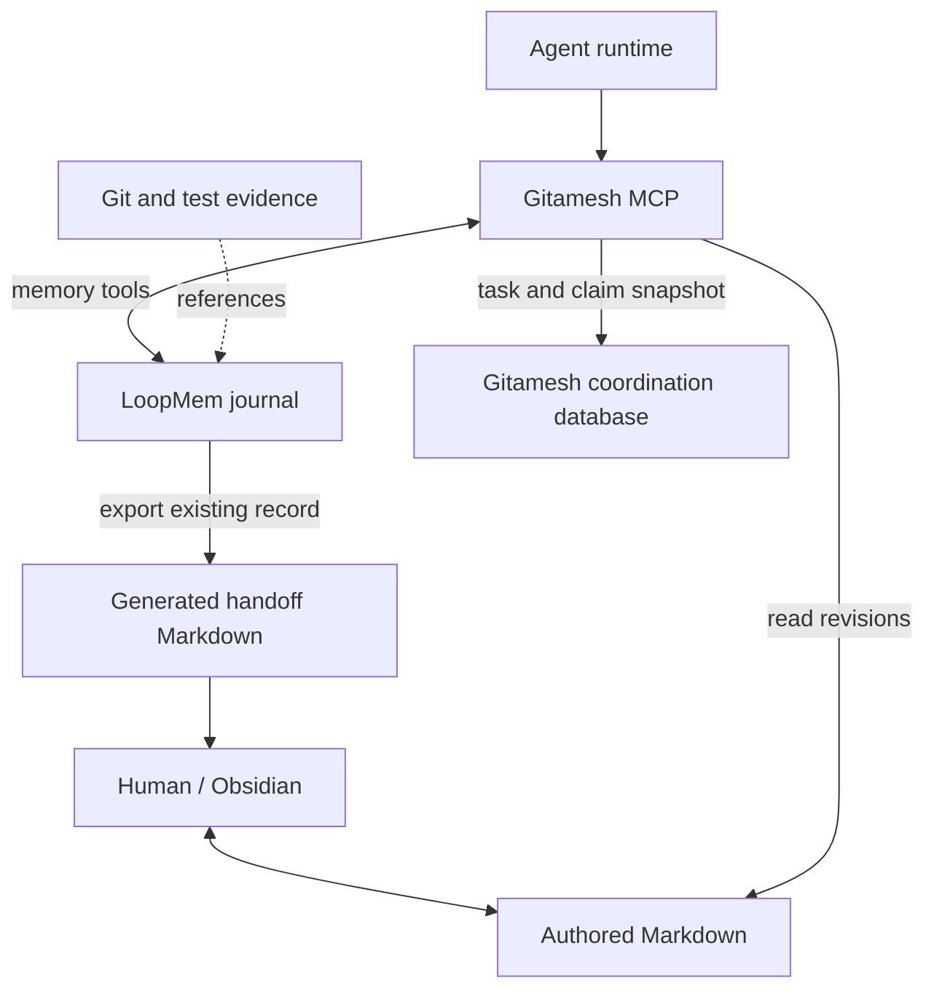

# Local knowledge and durable handoffs

Date: November 25, 2026. First shared-knowledge milestone.

Gitamesh can read an explicitly configured local Markdown folder, combine its
notes with current memory and coordination context, and export an existing
LoopMem record as a readable handoff. The folder can be an Obsidian vault or
ordinary files. Obsidian is optional.

The accepted direction is a user-owned, agent-neutral workspace: people retain
their documents, agents share useful context across sessions, and Gitamesh
coordinates work through its existing task and ownership system. The decision
and remaining scope are recorded in
[the shared-knowledge ADR](adr/2026-11-25-shared-knowledge.md).

## Where information belongs

| Information | Authority | Role in this milestone |
| --- | --- | --- |
| Authored goals, requirements, decisions, research | Original Markdown files | Read directly; return relative paths and SHA-256 revisions. |
| Source code and observed verification | Git repository and actual test results | Reference evidence; a note does not establish that code works. |
| Task state, ownership, leases, resource claims, fencing | Gitamesh daemon and its configured coordination database | Read current task and claim summaries. Existing PostgreSQL mode remains available; this feature does not change storage configuration. |
| Attributed observations, failures, next actions, supersession | Existing LoopMem journal | Retrieve memory; export a specific saved record. |
| Human navigation and editing | Obsidian or another editor | Work with the same open files. |
| Exported handoff Markdown | Historical projection of a LoopMem record | Readable artifact; current validity and supersession remain in LoopMem. |



There is no second document database or persistent knowledge index. Authored
notes remain files; shared memory keeps its existing store.

## Build and bind a folder

Use Node.js 24 or later and the repository's pinned pnpm version. From the
Gitamesh checkout:

```bash
npx --yes pnpm@10.33.1 install --frozen-lockfile
npx --yes pnpm@10.33.1 -r --if-present run build
```

Choose an existing local notes directory and the **actual Gitamesh repository
ID** for the project. For a registered project, use its registered ID; the CLI's
`gitamesh repo status --json`, run in that project's checkout, exposes its local
repository ID. Keep the same identity for notes, memory, and task queries.

```bash
export GITAMESH_KNOWLEDGE_ROOT=/absolute/path/to/project-notes
export GITAMESH_KNOWLEDGE_REPOSITORY_ID=repo_your_registered_id
```

The root must be absolute and both variables must be configured together. Each
MCP process binds one folder to one repository. A tool call cannot choose a new
absolute root or access the binding under another repository ID.
Repository IDs accept at most 256 UTF-8 bytes, without surrounding whitespace
or control characters.

### Read locally from the CLI

From the Gitamesh checkout, the compiled CLI works without a global install:

```bash
node packages/cli/dist/bin/gitamesh.js knowledge read "Decisions/Database.md" --json
node packages/cli/dist/bin/gitamesh.js knowledge context --query PostgreSQL --json
node packages/cli/dist/bin/gitamesh.js knowledge context --path Goals.md --path Constraints.md --max-bytes 8192
```

An installed `gitamesh` command exposes the same subcommands. These commands
read local files without contacting a daemon, LoopMem, or a model. `--path` is
repeatable. Text queries perform case-insensitive substring matching against
relative paths and note contents. This is bounded selection, not semantic or
exhaustive retrieval.

`read` returns `path`, `sha256`, `bytes`, and `content`. `context --json` returns
the repository ID, selected notes, rendered Markdown, `truncated`,
`omittedCount`, and `scannedCount`. Human-readable context reports truncation on
stderr. `omittedCount` counts known candidates only; it does not estimate files
that were never scanned.

### Connect an MCP client

Point a local stdio MCP client at:

```text
node /absolute/path/to/gitamesh/packages/mcp-server/dist/index.js
```

Configure the environment on that MCP process, not only in an unrelated shell.
Existing client registration examples are in the
[MCP README](../packages/mcp-server/README.md#usage-examples).

| Environment variable | Meaning |
| --- | --- |
| `GITAMESH_KNOWLEDGE_ROOT` | Absolute local knowledge folder. |
| `GITAMESH_KNOWLEDGE_REPOSITORY_ID` | Exact repository identity bound to that folder. |
| `GITAMESH_KNOWLEDGE_WRITABLE` | Defaults to `false`; set exactly `true` to enable immutable handoff export. Does not enable arbitrary note edits. |
| `GITAMESH_LOOPMEM_STORE` | Optional absolute persistent local LoopMem store. Without it, memory is disabled and handoff export is unavailable. |
| `GITAMESH_LOOPMEM_BIN` | Optional installed LoopMem executable; defaults to `loopmem` on PATH. |
| `GITAMESH_URL` | Existing daemon URL; MCP defaults to `http://127.0.0.1:8787`. |
| `GITAMESH_TOKEN` | Existing daemon credential for task and claim reads. Keep credentials outside committed configuration. |

LoopMem installation and initialization follow
[the existing continuity guide](loopmem-global-continuity.md). Initialize a
repository namespace once with `gitamesh_memory_init`; reuse it across sessions.
Knowledge reads do not initialize memory automatically.

## MCP tools

| Tool | Input and result |
| --- | --- |
| `gitamesh_knowledge_read` | `repositoryId`, `path`; returns one note and its SHA-256. No daemon or memory call. |
| `gitamesh_knowledge_context` | `repositoryId`; optional `query`, `paths`, `maxNotes`, `maxBytes`, `includeMemory`, `includeCoordination`. Returns a bounded packet with authored notes and independently reported source states. |
| `gitamesh_export_handoff` | `repositoryId`, existing `memoryId`; optional `expectedSources` containing `{path, sha256}` pairs. Exports that record without creating another memory entry. |

Example input for combined context:

```json
{
  "repositoryId": "repo_your_registered_id",
  "query": "PostgreSQL",
  "maxNotes": 5,
  "maxBytes": 16384,
  "includeMemory": true,
  "includeCoordination": true
}
```

Memory and coordination are included by default. Set both switches to `false`
for a local-only MCP packet. The packet reports `observedAt`, source revisions,
and separate states for `knowledge`, `memory`, `tasks`, and `claims`:

- `available`: the source was read successfully.
- `disabled`: the optional memory service was not configured.
- `unavailable`: a requested source could not be read or validated.
- `omitted`: the caller explicitly excluded the source.

Each source also reports truncation. `packet.partial` is true when any source
is not available or was truncated, including an intentional omission. An
unavailable claim source does not mean there are no claims. The packet combines
independent reads; it is not an atomic database snapshot or a lease.

LoopMem supplies its own bounded context selection as plain text. Its interface
does not expose completeness metadata. `memory.truncated: false` means this
packet builder did not further crop that supplied selection; it does not mean
the entire memory journal was included.

### Budgets and file scope

| Limit | CLI local context | MCP combined context |
| --- | --- | --- |
| Default `maxBytes` | 16,384 | 16,384 |
| Accepted `maxBytes` | 512–65,536 | 4,096–65,536 |
| What the byte budget measures | UTF-8 bytes of returned `markdown` only | UTF-8 bytes of compact JSON for the complete successful `{ok: true, packet}` structured result |
| Default / maximum notes | 10 / 50 | 10 / 50 |
| Individual note limit | 65,536 UTF-8 bytes | 65,536 UTF-8 bytes |
| Automatic discovery limit | 2,000 directory entries | 2,000 directory entries |

The CLI's JSON representation includes additional fields and can exceed its
Markdown budget. The MCP transport envelope and rendered text copy are outside
the compact structured-result budget. Neither budget is a model token limit.
Combined context may fit fewer notes than a CLI packet with the same numeric
budget because it includes other sources and metadata.

Only visible, regular UTF-8 `.md` files are read. Absolute note paths, parent
traversal, symlinks, and hidden path segments are rejected. The reserved root
`Handoffs/` directory is excluded from automatic authored-note discovery;
explicit `read` or `paths` can retrieve a generated handoff. Canvas, Bases,
attachments, and editor configuration are not interpreted in this milestone.

## Save memory, then export the handoff

The existing memory operation and the new file export are separate steps so an
export retry cannot duplicate a durable memory record.

1. Read current context and retain relevant `{path, sha256}` source pairs.
2. Call existing `gitamesh_memory_remember` with the repository ID, agent ID,
   workspace session ID, memory kind, report, and evidence. Include the actual
   task/attempt IDs where relevant. Save the returned memory ID.
3. With `GITAMESH_KNOWLEDGE_WRITABLE=true`, call `gitamesh_export_handoff` using
   that ID and the retained pairs as `expectedSources`.
4. After an export failure, retry export with the **same memory ID**. If a source
   changed, reread it and reconsider the report before exporting. If the memory
   save itself timed out, inspect memory to determine its outcome before
   repeating that save.

Example memory input, with identifiers replaced by your actual session values:

```json
{
  "repositoryId": "repo_your_registered_id",
  "agentId": "agent_your_registered_id",
  "workspaceSessionId": "session_your_current_id",
  "kind": "next",
  "text": "The note adapter is implemented. Next: verify the configured second agent can retrieve the same sources and memory.",
  "evidence": ["git:your-verified-commit", "knowledge:Decisions/Database.md"]
}
```

For export, pass `memoryId` from that response. Copy the exact `path` and
`sha256` values from `gitamesh_knowledge_read` or
`packet.sources.knowledge.notes` into the optional `expectedSources` array.
Omitting this array requests no freshness check; the result explicitly reports
`sourceCheck.status: "not-requested"`.

Exports use `Handoffs/<sha256-of-repository-id>-<memory-id>.md`. The generated
file contains the saved report, provenance, evidence, and supersession reference.
Publication uses a complete temporary file and an atomic, non-replacing hard
link on a supporting local filesystem. Repeating the same export returns
`replayed: true`. Different content at the same path produces a conflict and is
not overwritten.

Source hashes are checked immediately before export. This is a preflight check,
not a transaction with human edits, sync, or task state. The operation neither
acquires a task claim, completes work, approves a decision, nor edits an
authored note. Current memory is still read from LoopMem, which may supersede a
record after its historical Markdown projection was created.

## Acceptance and verification

| Scenario | Required outcome |
| --- | --- |
| Two independently configured MCP clients read the same binding | Both receive the same unchanged source bytes and hashes. |
| One session saves a memory record; another exports its ID | The export preserves attribution and evidence without another memory save. |
| An authored source changes before export | Its stale expected hash is rejected. |
| An export is retried or performed concurrently | Identical exports converge on one file; conflicting bytes are not replaced. |
| Memory or coordination is absent, failing, or malformed | Source status reports the condition without claiming the source is empty. |
| Packet budgets are small or the folder is large | Selection stays bounded and reports truncation or incomplete discovery. |
| A caller requests an escaped path or another repository binding | Access fails before returning source content. |
| Automatic context runs after handoff export | Generated history is not silently promoted into authored current knowledge. |

Run focused repository verification after building:

```bash
npx --yes pnpm@10.33.1 exec vitest run packages/knowledge packages/cli packages/mcp-server
npx --yes pnpm@10.33.1 --filter @gitamesh/knowledge --filter @gitamesh/cli --filter @gitamesh/mcp-server run typecheck
```

Real LoopMem verification additionally requires an installed binary and the
existing `LOOPMEM_TEST_BIN` tests. MCP transport and executable-fixture tests
validate the integration contracts; they do not establish a successful live
handoff inside Claude, Codex, or an Obsidian session. That acceptance exercise
must be performed with the user's configured clients and local folder.

## Next milestones

This milestone delivers local Markdown reads, bounded combined context, and
immutable export of existing memory. Later work can add a reviewed publishing
workflow for authored notes, approvals with enforcement at the actual write
boundary, Canvas/Bases views, lifecycle hooks across runtimes, and a supported
cross-host memory service. Those require their own acceptance criteria.

The current LoopMem bridge coordinates local processes on one host. File sync,
shared folder copies, or the presence of a PostgreSQL daemon do not make its
memory store a validated cross-host system. This feature does not install
Obsidian, start agents, sync vaults, or deploy a service.
